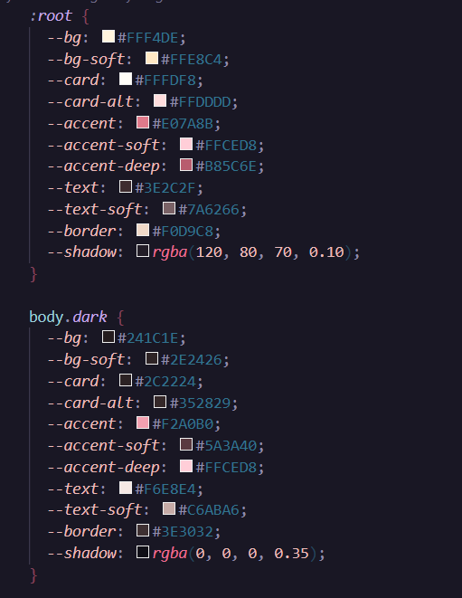
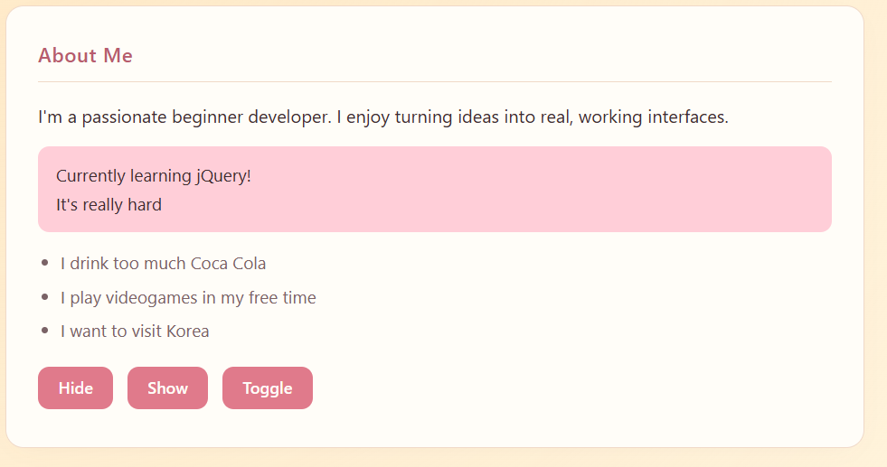
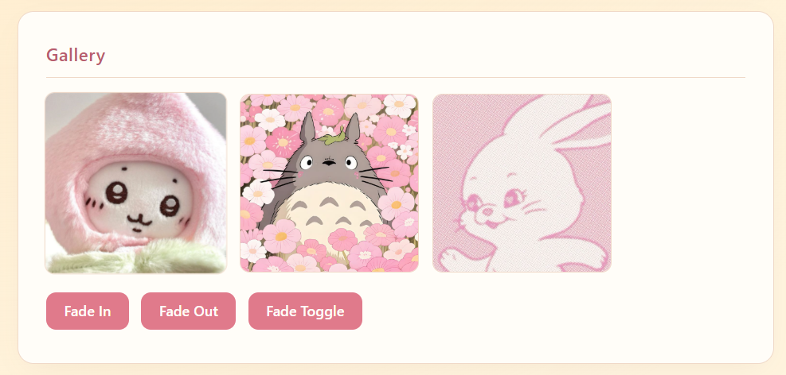
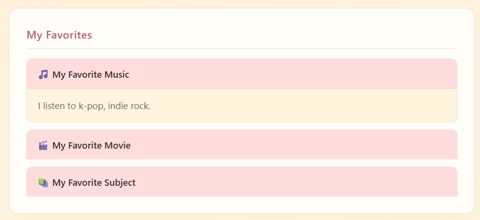
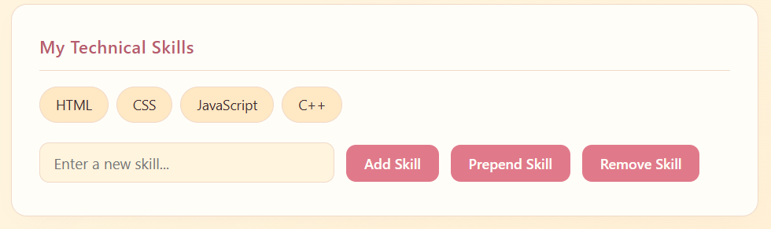
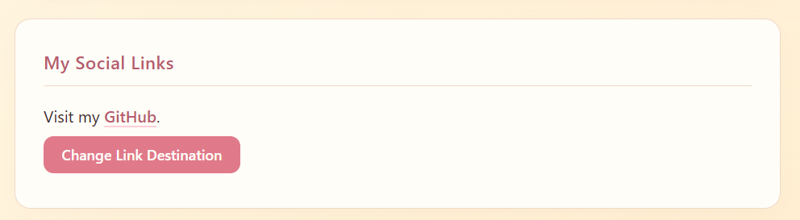
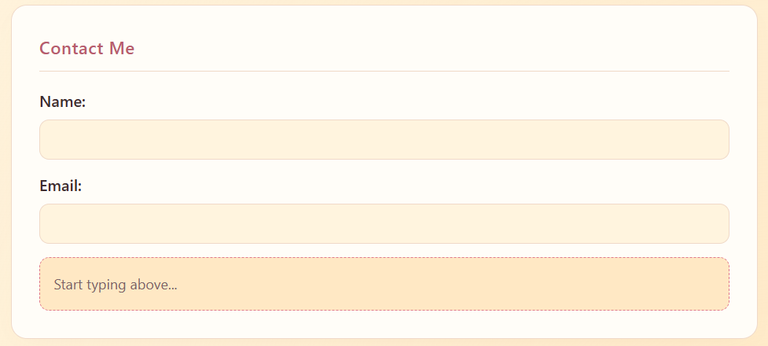
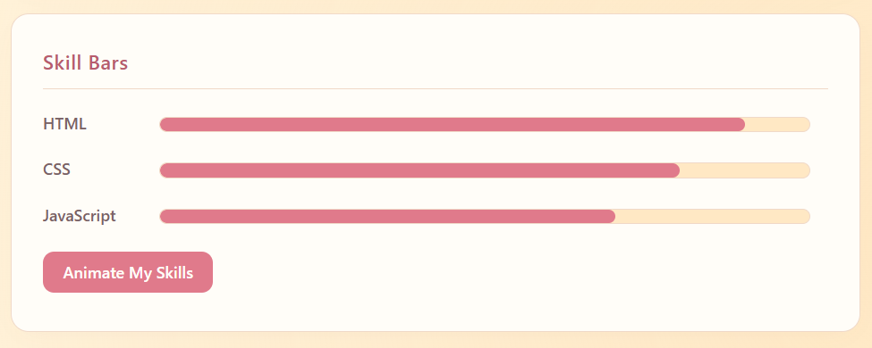

# jQuery Portfolio Project

**Student:** Dayana Zharylgapova
**Group:** SE-2538

[GitHub Pages Link](https://github.com/Tokisao)

## Overview
A personal portfolio website built with HTML, CSS, and jQuery.
Covers selectors, effects (show/hide, fade, slide), DOM manipulation,
form interaction, and animations.

### Task 0 — Setup
jQuery loaded from CDN (3.7.1). `$(document).ready()` prints "jQuery is ready!" in console.

### Task 1 — Selectors & CSS
Tag/ID/class selectors used. Greeting updates dynamically. Light/dark theme toggle.

\

### Task 2 — Visibility Methods
Hide, Show, Toggle buttons for "About Me" status message.

### Task 3 — Fade Methods
FadeIn / FadeOut / FadeToggle on gallery images.

### Task 4 — Slide Methods
Clickable headings with slideToggle panels.

### Task 5 — Add & Remove Elements
Skills list with add/prepend/remove. Empty input is prevented.

### Task 6 — Modifying Attributes
Button swaps GitHub ↔ LinkedIn using `.attr()`.

### Task 7 — Form Interaction
Live preview of Name and Email using `.val()` and `.text()`.

### Task 8 — Basic Animation
Skill bars animated from 0 to target width with `.animate()`.

## 📝 Work Summary
I built a single-page portfolio divided into 8 clearly labeled
sections — one per task. Each section uses a distinct jQuery feature:
`.text()`, `.css()`, `.hide()`, `.fadeIn()`, `.slideToggle()`,
`.append()`, `.attr()`, `.val()`, and `.animate()`.
